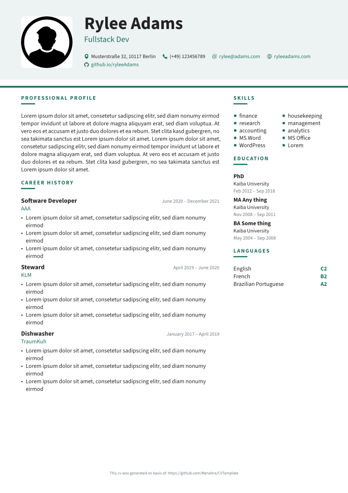
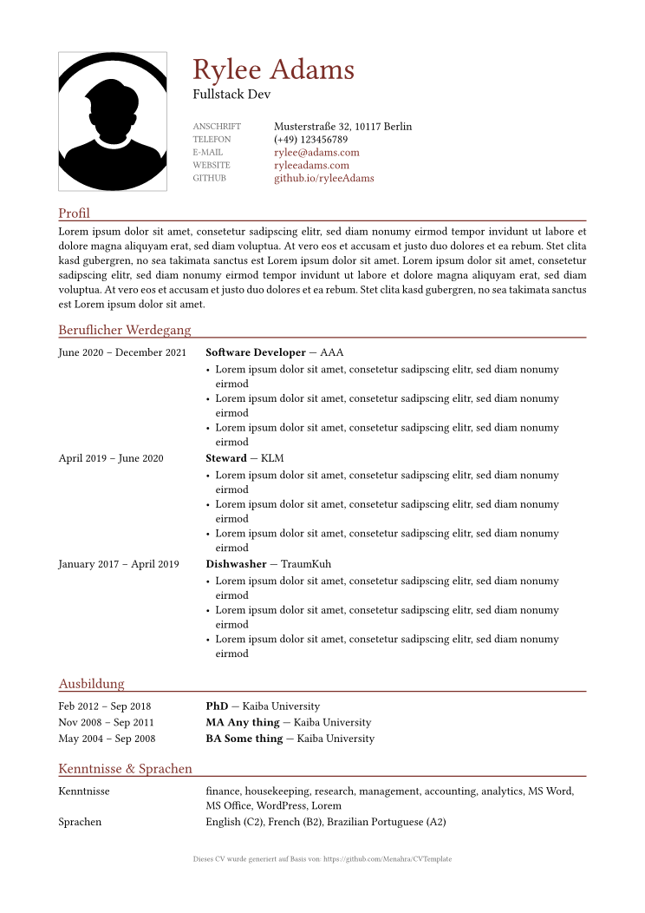
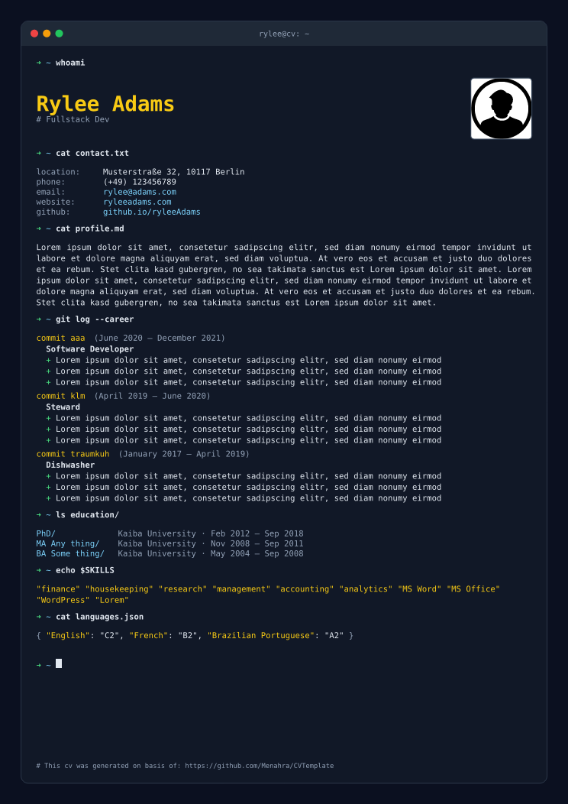

# Typst CV Template

This project provides a template for generating a curriculum vitae based on the great [typst programming language](https://typst.app). Please refer to the official documentation of typst to learn how to compile the given template.

## Designs

The template ships with three designs ("themes"). All of them render the same applicant data, so switching is a single setting.

| `modern` (default) | `classic` | `terminal` |
| --- | --- | --- |
|  |  |  |

Choose the design with `"theme"` in the config file, or with the `theme:` argument (see below).

## Usage

```typst
#import "CVTemplate.typ": CVTemplate

#show: document => CVTemplate(
  "./test/applicant.json",           // applicant data
  "./test/config.json",              // config, or none
  "./test/DefaultApplicantPhoto.svg",// photo, or none
  "en_US",                           // locale
  // theme: "classic",               // optional, overrides the config
)
```

Compile it with the bundled fonts:

```sh
typst compile test/CVTemplateTest.typ --root . --font-path fonts
```

The `modern` theme uses [Source Sans 3](https://github.com/adobe-fonts/source-sans), which is included in `fonts/` (SIL Open Font License). The other themes only use fonts that come with typst. In the typst web app, upload the `fonts/` folder together with the template.

## Parameters

- **jsonFilePath**: path to the applicant data (see [test/applicant.json](test/applicant.json)). An already loaded dictionary works too.
- **configJsonFilePath**: path to the config file, or `none`.
- **photoPath**: path to the photo shown on the CV, or `none` for no photo. Raw image bytes work too.
- **locale**: the language of the headings and labels. The supported locales are the file names in `translations/` (`en_US`, `de_DE`).
- **theme** (optional, named): `"modern"`, `"classic"` or `"terminal"`. It takes precedence over the config.

All paths are relative to the root of this project, i.e. to `CVTemplate.typ`.

## Config

```json
{
  "showAttribution": true,
  "theme": "modern",
  "accentColor": "#1F6F5C"
}
```

- **showAttribution**: shows a small note at the end of the CV that links to this template. Defaults to `true` when a config file is given.
- **theme**: the design to use. Defaults to `modern`.
- **accentColor**: optional, replaces the theme's accent colour.

## Applicant data

See [test/applicant.json](test/applicant.json) for a complete example.

- **name**, **jobTitle**, **profile**
- **location**, **phone**, **email**, plus the optional **website** and **github**
- **skills**: one list of everything you know, tools and software included
- **languages**: a list of `{ "name": "French", "level": "B2" }`. The level is optional, and plain strings work too.
- **workHistory**: a list of `{ "name", "role", "from", "to", "tasks" }`, newest first. Leave out `to` for your current position.
- **education**: a list of `{ "title", "institute", "from", "to" }`
- **additional** (optional): further sections as `{ "title", "items" }`, e.g. hobbies or certificates

### Previous data format

Data files written for earlier versions keep working (see [test/applicant-legacy.json](test/applicant-legacy.json)):

- an `additional` entry titled `Software` is merged into `skills`
- an `additional` entry titled `Languages` is used as `languages`
- `description` in `workHistory` is used as the role

Note that the photo path is now relative to the project root rather than to `content/`.
